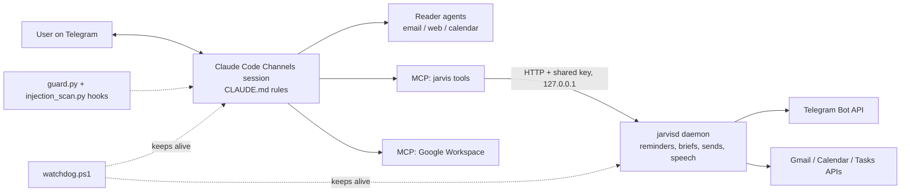

# telegram-personal-agent

A personal assistant ("Jarvis") that runs on a home PC and is used entirely from Telegram: tasks, timed reminders, calendar, mail triage, Hebrew voice notes and approved scheduled sends, with prompt-injection defenses around everything it reads.

## Features

- Telegram chat on top of a Claude Code Channels session, with tap-to-answer quick-reply buttons
- Google Tasks capture with first-step subtasks, postpone counters and a weekly review
- Timed reminders, morning brief and evening summary sent by a plain-code daemon (no model tokens)
- Hebrew natural-language date parsing ("מחר בשלוש", "יום חמישי הבא בערב")
- Hebrew voice notes in (local whisper) and spoken replies out
- Gmail labelling, summaries, follow-up detection for unanswered mail, deadline extraction
- Scheduled email and WhatsApp Web sends that need one explicit approval of the exact text, recipient and time
- Twice-daily autonomous "work sessions" that research, draft and report, but never send, pay or submit
- Security: untrusted content (mail, web, calendar invites) is read only by sandboxed reader agents; a PreToolUse guard hook enforces hard rules; a PostToolUse scanner flags injection attempts; learned permissions are narrow (one recipient, one site)
- Watchdog that keeps the session and daemon alive across crashes, sleep and network loss
- Hebrew user interface; code and docs in English

## Architecture



Details and the decisions log: `ARCHITECTURE.md`.

## Stack

Python 3.11+, Claude Code (Channels, subagents, hooks, MCP), MCP Python SDK, Google APIs via workspace-mcp, faster-whisper / whisper.cpp, edge-tts, PowerShell + Windows Task Scheduler for the watchdog, pytest.

## Run

1. `python -m venv .venv` and `pip install -r requirements.txt`
2. Copy `.env.example` to your environment and set at least `JARVIS_CHAT_ID` and `JARVIS_USER_EMAIL` (they have no defaults).
3. Copy `.mcp.example.json` to `.mcp.json`, `memory.example/` to `memory/`, and `permissions/learned.example.json` to `permissions/learned.json`.
4. Put a Google OAuth `client_secret.json` in `~/.jarvis/` and run `python -m jarvis.google_login` once.
5. Start everything with `watchdog.ps1` (Task Scheduler at logon), or run `python -m jarvis.daemon` and the Claude Code Channels session by hand.

Environment variables (`.env.example`): `TELEGRAM_BOT_TOKEN`, `JARVIS_CHAT_ID`, `JARVIS_USER_EMAIL`, `JARVIS_TASKLIST_ID`, `JARVIS_MAIL_LABELS`, `JARVIS_WATCH_QUERY`, `JARVIS_USER_NAME`, `JARVIS_HOME`, `JARVIS_PORT`, `JARVIS_WHISPER`, `JARVIS_WHISPER_PROMPT`.

## Tests

```bash
JARVIS_HOME=$(mktemp -d) pytest -q
```

198 offline unit tests pass (plus 8 expected failures that track known injection-detection gaps). No network or credentials needed.

Built by directing AI coding agents (Claude Code); I own the spec, architecture, testing and deployment.
